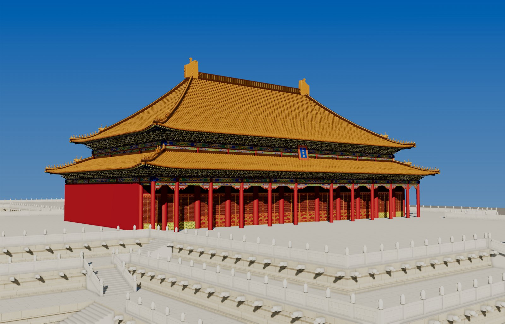

# 太和殿 · 代码三维还原

用代码（Three.js）从零搭建的北京故宫太和殿外观模型。每个尺寸都有出处；查不到实测值的地方，按清代《工程做法》推算，或从公开照片测量，并在数据里标明。



## 内容

| 文件 | 说明 |
|---|---|
| [`index.html`](index.html) | 可交互网页：拖动旋转、滚轮缩放，六个预设视角，附数据与出处面板 |
| [`video/taihedian_16x9.mp4`](video/taihedian_16x9.mp4) | 24.5 秒横屏短片：按真实工序建起大殿，再卡点展示细节，配乐为合成 |
| [`data/taihedian.json`](data/taihedian.json) | 模型用到的全部数据：参数（含出处标签）、柱网、台基、台阶、月台陈设、构件数量 |
| [`src/params.js`](src/params.js) | 参数表：所有数字只写在这里，每条附出处和说明 |
| `src/` | 生成器：斗拱、屋面与瓦作、脊饰、彩画、台基、陈设、建造动画、短片镜头 |
| `hall.html` | 渲染与短片出图用的页面（`tools/film.py`、`tools/shot.py` 调用） |
| `corner.html`、`bracket_test.html` | 开发过程中的屋角样片与单攒斗拱测试 |
| `audio.py` + `soundtrack.wav` | 短片配乐（代码合成） |
| `tools/` | 出图、出片、混音、数据导出脚本 |

## 打开网页

直接用 Chrome 或 Edge 打开 `index.html` 即可，场景加载约 5 秒。也可以用 GitHub Pages 的在线地址打开（见仓库主页右侧）。

## 主要数据与出处

| 项目 | 数值 | 出处 |
|---|---|---|
| 形制年代 | 清康熙三十四年（1695）重建，三十六年竣工 | 故宫博物院官网；王子林 2020 |
| 面阔 | 11 间，59.82 m（明间 8.43、次间 5.54、边间 3.55） | 《太和殿纪事》（王子林、刘畅转引） |
| 进深 | 5 间，33.15 m | 同上 |
| 高度 | 殿身 26.92 m，连台基通高 35.05 m；檐柱 7.36 m | 官网；《太和殿纪事》 |
| 柱 | 72 根：檐柱 32、金柱 40（径 1.02 m） | 《拆开太和殿》；《太和殿纪事》 |
| 斗拱 | 下檐单翘重昂七踩，上檐单翘三昂九踩；斗口约 8.5 cm | 学术文献；斗口由照片数攒反推 |
| 瓦 | 二样黄琉璃；模型生成勾头 下檐 568 / 上檐 492（档案 586 / 约 504） | 《太和殿纪事》 |
| 脊饰 | 正吻高 3.40 m；每条戗脊仙人 + 10 走兽 | 官网 |
| 台基 | 三层汉白玉须弥座，高 8.13 m | 官网；平面见下 |
| 月台 | 铜鼎 18，日晷、嘉量各一，铜龟、铜鹤各一对 | 官网；位置由卫星影像测得 |

完整清单见 `data/taihedian.json` 和 `src/params.js`。出处标签：`record` 为《太和殿纪事》，`dpm` 为故宫博物院官网，`photo` 为照片测量，`rule` 为按《工程做法》推算，`fit` 为与照片拟合。

制作方案与数据整理文档：<https://claude.ai/code/artifact/71dc7d4d-dab2-424a-aa0f-2990867245c7>

### 推算与近似的部分

- 举架、出檐、翼角「冲三翘四」按《工程做法》推算，再用照片校正。
- 三层台基的平面取自 OpenStreetMap 的建筑轮廓（© OpenStreetMap contributors，ODbL），整理成对称形，并按 Esri 卫星影像整体北移 6.9 m。按此生成的螭首为 1175 个，文献记载为 1142 个。
- 铜龟、铜鹤的位置由卫星影像上的阴影推断，是近似值。
- 走兽、正吻、螭首等雕塑类构件只还原了外形、比例和顺序，表面雕刻是简化的。
- 不含殿内，也不含周边建筑。

## 参考资料

- 故宫博物院 · 太和殿：<https://www.dpm.org.cn/explore/building/236465.html>
- 王子林《清代太和殿的两次重建》，《故宫博物院院刊》2020 年第 10 期：<https://www.dpm.org.cn/Uploads/File/2020/11/12/u5facb9ce9f26b.pdf>
- 刘畅等「人文清华故宫行」直播实录（转引《太和殿纪事》各间尺寸）：<https://m.thepaper.cn/baijiahao_10622313>
- 《拆开太和殿，你会看到什么？》（星球研究所，周苏琴审）：<https://www.thepaper.cn/newsDetail_forward_8974236>

建模时用到的 Wikimedia Commons 公开照片只作对照，不包含在本仓库中。

## 重新出片

需要 Python（playwright、numpy、scipy、pillow）、ffmpeg 和 Chrome。

```bash
python tools/film.py                                   # 渲染画面 -> out/frames_16x9.mp4
python audio.py                                        # 合成配乐 -> soundtrack.wav
python tools/finish.py --name 太和殿 --fmt 16x9 --grain 0   # 混合、响度 -14 LUFS -> out/太和殿_16x9.mp4
python tools/export_data.py                            # 导出数据 -> data/taihedian.json
```

第三方代码：`vendor/` 中为 Three.js r147 及其示例模块（MIT 许可）。
